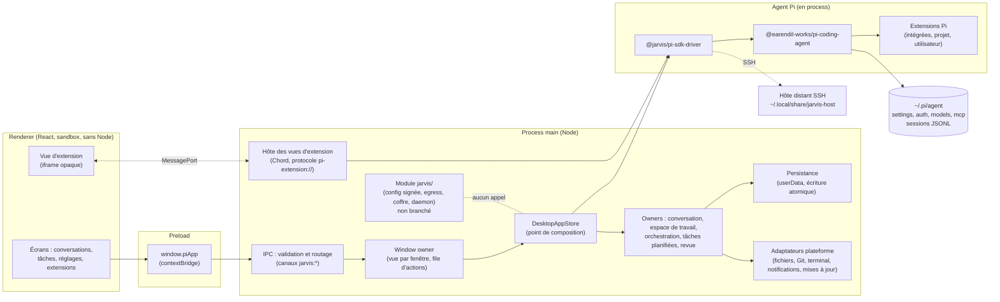

# Architecture

Ce document décrit comment Jarvis est construit aujourd'hui. Il est rédigé à partir du code ; les
chemins cités sont relatifs à la racine du dépôt. La référence détaillée des owners, de la
persistance, de la revue de code et des captures de tour reste
[architecture-ownership.en.md](architecture-ownership.en.md) (en anglais) : en cas de doute sur une
règle d'ownership, c'est elle qui fait foi.

## Vue d'ensemble

Jarvis est une application Electron en trois bundles séparés, construits par electron-vite
([`apps/desktop/electron.vite.config.mjs`](../apps/desktop/electron.vite.config.mjs)) :

| Bundle       | Point d'entrée                                               | Rôle                                                                             |
| ------------ | ------------------------------------------------------------ | -------------------------------------------------------------------------------- |
| **main**     | [`electron/main.ts`](../apps/desktop/electron/main.ts)       | Process Node : fenêtres, owners, persistance, pilote Pi, adaptateurs plateforme. |
| **preload**  | [`electron/preload.ts`](../apps/desktop/electron/preload.ts) | Pont étroit : expose l'API typée `window.piApp` au renderer via `contextBridge`. |
| **renderer** | [`src/main.tsx`](../apps/desktop/src/main.tsx)               | Interface React 19. Aucun accès à Node ni à Electron.                            |

Le monorepo pnpm contient quatre paquets internes, publiés sous le scope `@jarvis/*` (non publiés
sur npm) :

| Paquet                                                 | Rôle                                                                                    |
| ------------------------------------------------------ | --------------------------------------------------------------------------------------- |
| [`@jarvis/session-driver`](../packages/session-driver) | Contrats portables d'une session (types, événements, capture de tour).                  |
| [`@jarvis/catalogs`](../packages/catalogs)             | Contrats et stockage du catalogue (espaces de travail, sessions, worktrees).            |
| [`@jarvis/pi-sdk-driver`](../packages/pi-sdk-driver)   | Adaptateur vers l'agent Pi (SDK en process), MCP, fournisseurs personnalisés, hôte SSH. |
| [`@jarvis/extension-ui`](../packages/extension-ui)     | Aide aux auteurs de vues d'extension et transport Chord côté navigateur.                |
| `@jarvis/desktop` ([`apps/desktop`](../apps/desktop))  | L'application elle-même.                                                                |

Des gardes exécutées en CI (`pnpm check:architecture`, `pnpm test:guards`, dossier
[`scripts/`](../scripts)) font respecter les sens de dépendance : le renderer n'importe ni Node ni
le code hôte, les paquets ne dépendent pas de l'application, les catalogues ne dépendent pas de
l'adaptateur Pi, et les IPC sensibles n'acceptent que la frame principale de la fenêtre.

## Schéma

## Chemin d'exécution d'une action

1. Le renderer appelle une méthode de `window.piApp`, exposée par
   [`preload.ts`](../apps/desktop/electron/preload.ts). Chaque méthode fait un
   `ipcRenderer.invoke` sur un canal nommé dans
   [`contracts/ipc.ts`](../apps/desktop/contracts/ipc.ts) (`desktopIpc`, environ 130 canaux préfixés
   `jarvis:`).
2. Le process main reçoit la requête dans
   [`ipc/register-desktop-ipc.ts`](../apps/desktop/electron/ipc/register-desktop-ipc.ts), la valide
   ([`ipc/request-validation.ts`](../apps/desktop/electron/ipc/request-validation.ts)) et la route.
   Les IPC de revue, de vues d'extension, de modèles d'atelier et de brouillons passent par
   [`mainFrameHandler`](../apps/desktop/electron/ipc/main-frame-ipc.ts), qui refuse tout émetteur
   autre que la frame principale de la fenêtre propriétaire.
3. Le [window owner](../apps/desktop/electron/windows/window-owner.ts) associe la requête à la
   fenêtre émettrice et à la session ciblée, puis la place dans la file d'actions de cette fenêtre
   ([`action-queue.ts`](../apps/desktop/electron/windows/action-queue.ts)). Seul « Stop » contourne
   la file, pour pouvoir interrompre une exécution en cours.
4. [`DesktopAppStore`](../apps/desktop/electron/application/app-store.ts) délègue l'opération à
   l'owner concerné, qui reçoit uniquement les capacités dont il a besoin.
5. Pour l'exécution de l'agent, l'owner passe par le pilote Pi
   ([`pi-sdk-driver.ts`](../packages/pi-sdk-driver/src/pi-sdk-driver.ts)), qui délègue à Pi.
6. Le nouvel état est projeté vers la fenêtre (`jarvis:state-changed`) ; les mises à jour de
   transcription en flux passent par un éditeur dédié
   ([`streaming-ui-publisher.ts`](../apps/desktop/electron/conversation/streaming-ui-publisher.ts)).

## Owners

Le code est rangé par composant propriétaire d'un comportement et d'un état mutable. Le dossier ne
suffit pas à établir une frontière : ce sont les types et les gardes qui la font respecter.

| Owner                     | Emplacement                                           | Responsabilité                                                                                            |
| ------------------------- | ----------------------------------------------------- | --------------------------------------------------------------------------------------------------------- |
| Composition               | `electron/application/`                               | `DesktopAppStore` : état agrégé privé, construction des owners par capacités bornées.                     |
| Fenêtres                  | `electron/windows/`                                   | Vue par fenêtre, sérialisation des actions, vidage des brouillons avant fermeture.                        |
| IPC                       | `electron/ipc/`                                       | Validation et routage des requêtes.                                                                       |
| Conversation              | `electron/conversation/`                              | Brouillons, pièces jointes, file de messages, commandes de session, transcription.                        |
| Espace de travail         | `electron/workspace/`                                 | Dossiers, sessions, worktrees Git, découverte des sessions Pi locales.                                    |
| Orchestration             | `electron/orchestration/`                             | Fils enfants, supervision, outils d'orchestration exposés à l'agent.                                      |
| Tâches planifiées         | `electron/scheduled-tasks/`                           | Planification locale, déclenchement, outils de planification exposés à l'agent.                           |
| Atelier (revue, captures) | `electron/workbench/`                                 | Comparaisons Git immuables, fichiers relus, dépôt Git de captures de tour.                                |
| Extensions                | `electron/extensions/`                                | Hôtes des vues d'extension, actions hôte bornées, actifs servis par protocole.                            |
| Persistance               | `electron/persistence/`                               | État d'interface, pièces jointes, tâches planifiées ; écriture atomique.                                  |
| Plateforme                | `electron/platform/`                                  | Fichiers, worktrees, terminal (node-pty), éditeurs, notifications, thème, mises à jour.                   |
| Distant                   | `electron/remote/`                                    | Découverte des hôtes `~/.ssh/config`, installation de l'hôte distant.                                     |
| **Jarvis**                | [`electron/jarvis/`](../apps/desktop/electron/jarvis) | Configuration signée, garde de sortie réseau, coffre de secrets, intégration de session. **Non branché.** |

Côté renderer : `src/app/` compose l'écran, `src/features/` contient les fonctionnalités
(conversation, fils, tâches planifiées, atelier, réglages, extensions, palette de commandes),
`src/ui/` les primitives visuelles et `src/i18n/` les catalogues de traduction.

## Persistance

### Données de l'application (`userData`)

Le process main appelle `app.setName("Jarvis")` ; sous Linux le dossier de données est donc
`~/.config/Jarvis`, sauf si `PI_APP_USER_DATA_DIR` est défini.

| Fichier ou dossier     | Owner              | Contenu                                                                      |
| ---------------------- | ------------------ | ---------------------------------------------------------------------------- |
| `catalogs.json`        | `@jarvis/catalogs` | Espaces de travail, sessions, worktrees, métadonnées de fichiers de session. |
| `ui-state.json`        | Persistance        | État d'interface (version 19), modèles d'atelier par tâche.                  |
| `scheduled-tasks.json` | Tâches planifiées  | Tâches, planification, cible, dernier passage.                               |
| `attachments/`         | Persistance        | Pièces jointes du compositeur.                                               |
| `reviewed-files.json`  | Atelier            | Fichiers marqués comme relus (5 000 au plus).                                |
| `turn-checkpoints/`    | Atelier            | Index et dépôt Git nu (`objects.git`) des captures avant/après chaque tour.  |
| `worktrees/`           | Espace de travail  | Worktrees Git créés par Jarvis.                                              |

Les écritures sont sérialisées par chemin : fichier temporaire synchronisé puis renommage, ancien
fichier conservé en `.bak`. Un fichier corrompu n'est jamais écrasé : la lecture repart du `.bak`
s'il est valide, sinon le démarrage s'arrête sur un diagnostic visible
([`atomic-file-write.ts`](../apps/desktop/electron/persistence/atomic-file-write.ts)). Un
`scheduled-tasks.json` corrompu est isolé : l'application démarre, l'exécuteur de tâches reste
arrêté.

### Données de l'agent Pi

Jarvis ne copie pas l'historique de Pi : il lit et écrit les fichiers de Pi à leur place habituelle,
partagés avec Pi lancé en terminal. Le dossier de l'agent est `~/.pi/agent`, ou celui que désigne
`PI_CODING_AGENT_DIR`.

| Fichier         | Contenu                                                          |
| --------------- | ---------------------------------------------------------------- |
| `settings.json` | Réglages globaux de Pi (modèle par défaut, modèles activés…).    |
| `auth.json`     | Identifiants des fournisseurs (OAuth ou clés d'API).             |
| `models.json`   | Fournisseurs personnalisés (points d'accès compatibles OpenAI…). |
| `mcp.json`      | Serveurs MCP globaux ; `.pi/mcp.json` pour ceux d'un projet.     |
| Sessions JSONL  | Historique des conversations, propriété de Pi.                   |

Les accès aux API privées de Pi sont isolés dans
[`packages/pi-sdk-driver/src/compat`](../packages/pi-sdk-driver/src/compat) (réglages globaux,
réglages de projet, persistance de session), pour qu'un changement amont casse à un seul endroit.

## Pilote Pi

[`@jarvis/pi-sdk-driver`](../packages/pi-sdk-driver/src) exécute Pi **dans le process main** via
son SDK (version `^1.4.0` dans `apps/desktop/package.json`). Il :

- supervise les runtimes et les sessions
  ([`runtime-supervisor.ts`](../packages/pi-sdk-driver/src/runtime-supervisor.ts),
  [`session-supervisor.ts`](../packages/pi-sdk-driver/src/session-supervisor.ts)) ;
- pose un **bail de session** ([`session-lease.ts`](../packages/pi-sdk-driver/src/session-lease.ts))
  pour qu'un fil ne soit pas ouvert par deux processus à la fois ;
- génère les titres de fils, calcule l'usage (tokens, coût, cache) ;
- lit et édite la configuration MCP
  ([`mcp-config.ts`](../packages/pi-sdk-driver/src/mcp-config.ts)) et les fournisseurs
  personnalisés ([`custom-provider-store.ts`](../packages/pi-sdk-driver/src/custom-provider-store.ts)) ;
- émet les points de capture de tour (`agent_start`, `message_start`, `agent_settled`) ;
- pilote un **hôte distant** pour les espaces de travail SSH
  ([`remote/`](../packages/pi-sdk-driver/src/remote)) : un petit programme installé dans
  `~/.local/share/jarvis-host` sur la machine distante, qui y possède les sessions Pi.

Le lanceur [`resources/pi-subagent-launcher.cjs`](../apps/desktop/resources/pi-subagent-launcher.cjs)
sert à lancer des sous-processus Pi ; il refuse d'utiliser l'exécutable Electron comme enfant Pi.

## Extensions

Trois mécanismes coexistent.

1. **Extensions intégrées** de Jarvis, enregistrées dans `main.ts` et désactivables dans les
   réglages :
   - `jarvis-thread-orchestration` : outils `create_child_thread`, `list_threads`,
     `read_thread`, `send_message_to_thread`, `archive_child_threads` ;
   - `jarvis-scheduled-tasks` : outils `create_scheduled_task`, `list_scheduled_tasks`,
     `update_scheduled_task`.
2. **Extensions Pi ordinaires** (projet, utilisateur, paquets) découvertes et chargées par Pi
   lui-même ; Jarvis affiche leurs outils, commandes et réglages. Une extension peut ajouter dans
   la conversation une carte (`pi.appendEntry("jarvis.card", …)`) ou une carte épinglée au-dessus
   du compositeur (`jarvis.pin`).
3. **Vues d'extension** (panneau latéral) : une extension déclare une vue ; le pont
   [`desktop-extension-bridge.ts`](../packages/pi-sdk-driver/src/desktop-extension-bridge.ts)
   la relie au catalogue chargé par Pi, et
   [`extension-view-owner.ts`](../apps/desktop/electron/extensions/extension-view-owner.ts) crée un
   hôte Chord par vue, tâche et génération de runtime. Côté renderer, la vue tourne dans une iframe
   d'origine opaque (`allow-scripts` seulement), reçoit un `MessagePort` dédié et ses actifs par le
   protocole `pi-extension://`, avec une CSP qui interdit le réseau, les workers et les frames
   imbriquées. Des exemples sont fournis dans
   [`examples/desktop-extensions`](../examples/desktop-extensions) (PR Review, Test Runs, GitHub,
   Usage, Trace).

## Module `electron/jarvis/` (ajouts propres à Jarvis)

| Fichier                                                                  | Rôle                                                                                   |
| ------------------------------------------------------------------------ | -------------------------------------------------------------------------------------- |
| [`managed-config.ts`](../apps/desktop/electron/jarvis/managed-config.ts) | Lecture, vérification Ed25519 et mise en cache du bundle de configuration de l'agence. |
| [`egress-guard.ts`](../apps/desktop/electron/jarvis/egress-guard.ts)     | Liste d'hôtes autorisés et `fetch` gardé qui refuse les redirections hors liste.       |
| [`secret-vault.ts`](../apps/desktop/electron/jarvis/secret-vault.ts)     | Coffre chiffré par `safeStorage`, références `{{secret:nom}}`, masquage des sorties.   |
| [`user-daemon.ts`](../apps/desktop/electron/jarvis/user-daemon.ts)       | Refus de root, autostart XDG, unités `systemd --user` des tâches planifiées.           |

Ces modules sont couverts par
[`tests/unit/jarvis-security.spec.ts`](../apps/desktop/tests/unit/jarvis-security.spec.ts)
(12 tests), mais **aucun n'est importé par le reste de l'application** : ni `main.ts`, ni un owner,
ni un écran ne les appelle. Voir [securite.md](securite.md) pour le détail et les limites.

## Construction et distribution

- `pnpm build` construit les paquets partagés, l'aide de notification macOS, les trois bundles et
  l'hôte distant.
- [`electron-builder.yml`](../apps/desktop/electron-builder.yml) produit l'AppImage Linux
  (`jarvis-<version>-x86_64.AppImage`, exécutable `jarvis`). Le crochet
  [`after-pack-linux-launcher.cjs`](../apps/desktop/scripts/after-pack-linux-launcher.cjs) renomme
  le binaire en `jarvis.bin` et le remplace par un script `jarvis` qui choisit le mode sandbox de
  Chromium (voir [securite.md](securite.md)).
- L'icône a une source unique, [`resources/icon.svg`](../apps/desktop/resources/icon.svg) ;
  [`scripts/build-icons.mjs`](../apps/desktop/scripts/build-icons.mjs) en génère `icon.png` et
  `icon.icns` (variable `CHROMIUM_PATH` si le navigateur de Playwright n'est pas installé). Le
  logo de l'écran « nouveau fil » (`JarvisLogoMark`) reprend le même dessin.
- [`scripts/install.sh`](../scripts/install.sh) installe la dernière release pour l'utilisateur
  courant, sans droits root ; voir [exploitation.md](exploitation.md).
- Le workflow [`jarvis-appimage.yml`](../.github/workflows/jarvis-appimage.yml) construit et
  publie ; voir [exploitation.md](exploitation.md).
- Des cibles macOS (dmg/zip) et Windows (nsis/portable) existent dans la configuration mais ne sont
  ni construites ni vérifiées par la CI de Jarvis.
